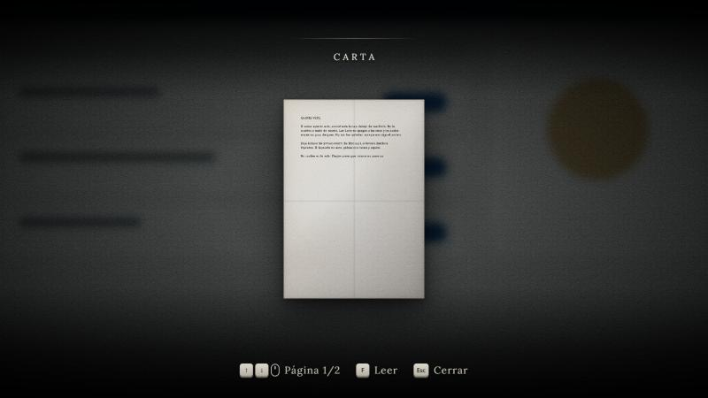
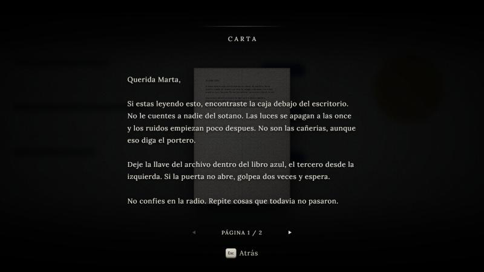

# Inventory

Extensión de Chrome que, al terminar de descargar un PDF o una imagen, congela la página
oscurecida y te levanta el archivo como un objeto que podés girar, mirar de cerca y leer.
Todo es local: no se envía nada a ningún servidor.

## Instalar

No hace falta instalar nada más: todo viene en el repo.

1. Descargá el repo: botón verde **Code → Download ZIP**, y descomprimilo.
2. Abrí `chrome://extensions`, activá **Modo de desarrollador** y tocá **Cargar descomprimida**.
3. Elegí la carpeta `extension/` del zip descomprimido.
4. Opcional, recomendado: en **Detalles** de la extensión activá **Permitir acceso a URLs de archivo**.
   Así el visor lee el archivo que bajaste directo del disco; sin eso, lo vuelve a pedir a la URL
   original (falla con archivos detrás de un login o generados al vuelo).

## Controles

| Tecla | Inspeccionar | Leer |
|---|---|---|
| Arrastrar | Girar | |
| Click apretado + rueda | Zoom | |
| Rueda / ↑ ↓ | Página (PDF) | Pantalla anterior / siguiente |
| ← → | | Pantalla anterior / siguiente |
| F / Espacio | Leer (PDF) o Ver (imagen) | Volver |
| Esc | Cerrar | Volver |

Leer muestra el texto del PDF en pantallas: corta donde deja de entrar en la vista, sin respetar
las páginas del PDF, y se pasa con el paginador de abajo. En imágenes y PDF escaneados, "Ver"
muestra la página plana y se desplaza con la rueda.

## Para desarrollar

`npm install` y `npm run vendor` vuelven a copiar pdf.js y la tipografía dentro de
`extension/vendor` (solo hace falta si actualizás esas librerías).

## Probar

- **Con la extensión cargada:** abrí `test/descargas.html` con doble click (no hace falta servidor);
  tiene un link de cada tipo. Necesita “Permitir acceso a URLs de archivo” activado.
- **Visor suelto, sin la extensión:** `node test/serve.cjs` y abrí
  http://localhost:5173/extension/viewer.html?demo=../test/carta.pdf&shot=../test/fondo.svg

`node test/make-sample.cjs` regenera el PDF de prueba y `node test/make-page.cjs` vuelve a armar
`descargas.html` con los archivos embebidos (Chrome ignora `download` en páginas `file://`, pero
sí descarga `data:` URLs).

## Limitaciones conocidas

- En páginas donde Chrome no deja inyectar (`chrome://`, Web Store, el visor de PDF de Chrome)
  el visor se abre en una pestaña propia.
- El sonido al abrir puede no sonar si el navegador lo bloquea; se destraba con la primera interacción.

## Licencia

[MIT](LICENSE). Podés usarlo, copiarlo y extenderlo libremente; la licencia pide conservar el
aviso de copyright y de licencia en las copias, así que el crédito a la autoría original se mantiene.
Si hacés algo con esto, me encantaría verlo.

## Créditos

- [pdf.js](https://github.com/mozilla/pdf.js), Apache-2.0.
- Tipografía [Lora](https://fonts.google.com/specimen/Lora), [OFL-1.1](https://openfontlicense.org/).
